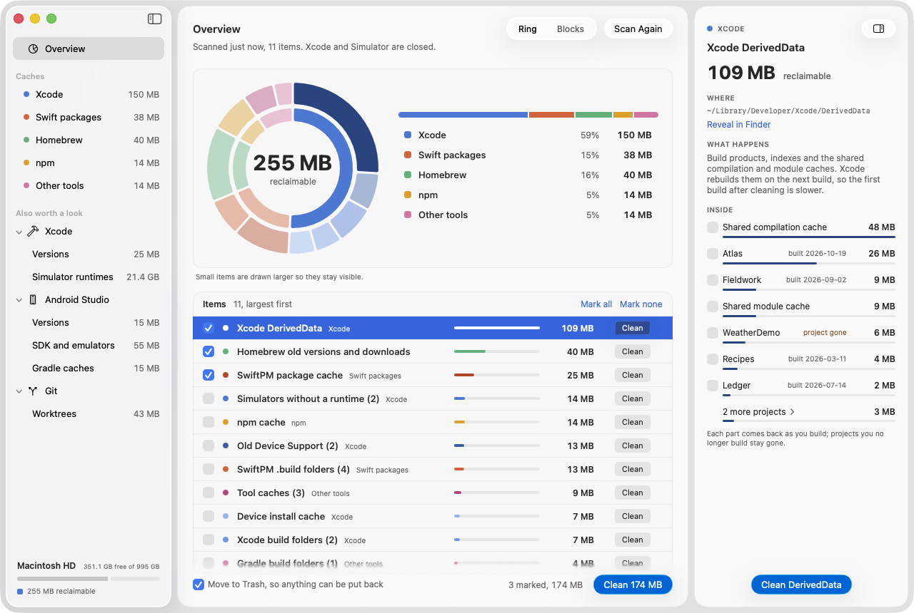
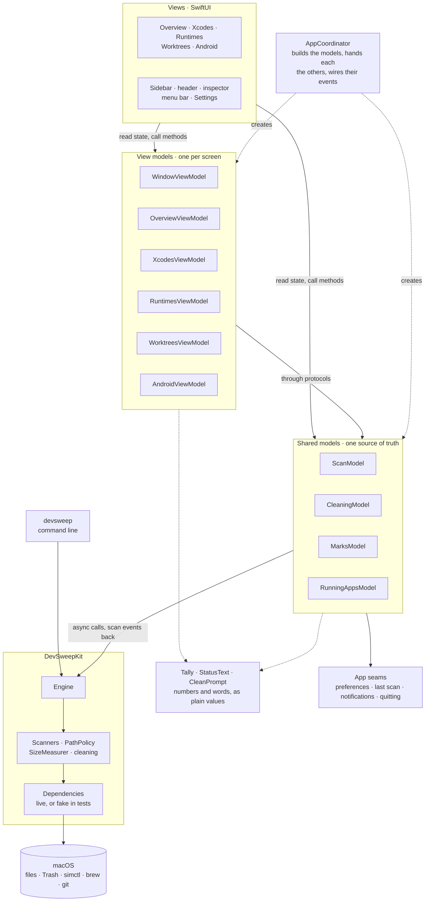

# DevSweep

See how much space developer caches take up on your Mac, and clean what you
choose. A SwiftUI app and a command line tool, `devsweep`, for macOS 26 on
Apple silicon.

[](https://github.com/JaviLorbada/devsweep/actions/workflows/ci.yml)
[](https://github.com/JaviLorbada/devsweep/releases)

[](LICENSE)

<picture>
  <source media="(prefers-color-scheme: dark)" srcset="docs/screenshot-dark.png">
  
</picture>

## What it does

- **Shows where the space went:** Xcode's DerivedData, old Device Support,
  SwiftPM, Homebrew, npm, Gradle and more, as a ring or as blocks.
- **Cleans what you mark**, to the Trash by default, with Put Back.
- **Cleans part of an item:** tick single DerivedData projects or build
  folders, and keep the rest.
- **Points at the rest:** installed Xcodes, simulator runtimes, Android
  Studio's SDK and emulators, and git worktrees, with what looks unused
  flagged.
- **Keeps an eye out:** a menu bar item with the free space, a daily scan,
  and a notification when DerivedData has grown a lot.
- **Works from the terminal too:** `devsweep` reports the same items and
  cleans them with `--run`.

## Safety first

DevSweep deletes only caches that tools rebuild or download again, and it is
built to err on the side of keeping things.

- **Report by default.** `devsweep` on its own only reports. It deletes only
  with `--run`, after asking; without a terminal to ask in, it needs `--yes`.
  The app only cleans when you press Clean.
- **Trash by default.** The app moves what it cleans to the Trash, with Put
  Back on each item. Deleting for good is a setting, and asks first.
- **Inside your home folder only.** A folder is acted on only if it is a
  directory, is not itself a symlink, and resolves strictly inside your home
  folder. Each one is checked again right before it goes; one that changed
  since the scan is skipped with a warning.
- **Never what git tracks.** Build folders are removed only when git provably
  tracks nothing in them. Any doubt keeps the folder.
- **Not while Xcode runs.** Cleaning the Xcode items waits until Xcode and
  Simulator have quit; DevSweep asks to quit them for you.
- **Worktrees only with nothing to lose.** DevSweep removes a git worktree
  only when you ask, with git's own `git worktree remove`, and only when it
  has no uncommitted changes and a branch holds every commit in it. The
  branch stays.
- **Never touched:** Xcode Archives (their dSYMs symbolicate crash reports),
  simulators that still work, simulator runtimes, installed Xcodes, Android
  Studio and its SDK and emulators, build folders tracked in git, and
  anything outside your home folder. Runtimes, Xcodes and Android Studio's
  files are listed with their sizes, and how to remove them yourself.
- It never runs as root.

If DevSweep ever deletes, or would delete, something it shouldn't, please
report it privately, as [SECURITY.md](SECURITY.md) describes.

## What it cleans

| Item | What | Where |
|---|---|---|
| `derived-data` | Xcode's build products, indexes and shared caches | `~/Library/Developer/Xcode/DerivedData`, or Xcode's custom location inside home |
| `simulators` | Simulators whose runtime is gone | removed by `xcrun simctl delete unavailable` |
| `device-installs` | Cached app installs for physical devices | the CoreDevice cache in `~/Library/Containers` |
| `device-support` | Device debug symbols, except the newest per device model | `~/Library/Developer/Xcode/<OS> DeviceSupport` |
| `swiftpm-cache` | SwiftPM's shared package clones | `~/Library/Caches/org.swift.swiftpm` |
| `swiftpm-builds` | `.build` folders next to a `Package.swift` | your project folders |
| `xcode-builds` | `build` folders holding Xcode output | your project folders |
| `gradle-builds` | `build` folders next to a Gradle build file | your project folders |
| `npm-cache` | npm's download cache | `~/.npm/_cacache`, `~/.npm/_npx` |
| `homebrew` | Old versions and downloads | removed by `brew cleanup` |
| `tool-caches` | CocoaPods, Carthage, Sourcery, Playwright and JetBrains Toolbox downloads; Playwright MCP's browser profiles stay | `~/Library/Caches` |

Project folders default to `~/Developer`, `~/Development`, `~/dev`,
`~/Documents/Workspace` and `~/Projects`; Settings changes them.

## Install

DevSweep needs macOS 26 on a Mac with Apple silicon.

Download it from the [releases page](https://github.com/JaviLorbada/devsweep/releases):
`DevSweep-<version>.zip` holds the app, `devsweep-<version>-macos.zip` the
command line tool.

Releases aren't notarized yet, so macOS won't open the app the first time.
Control-click it in Finder and choose Open, or allow it in System Settings >
Privacy & Security. For the tool, after unzipping, run
`xattr -d com.apple.quarantine devsweep`.

### From source

```bash
git clone https://github.com/JaviLorbada/devsweep.git && cd devsweep
make app                       # builds build/DevSweep.app
Scripts/install-cli.sh         # links devsweep into ~/.local/bin
```

## Using the app

- **Scan and clean.** DevSweep scans when it opens. Mark items and press
  Clean, or click Clean on a single row.
- **Keep part of an item.** Select DerivedData and tick single projects, or
  a shared cache, in the inspector, then clean just those. Build folders
  work the same way. A project can go while Xcode is open, after a question.
- **Look at what it won't clean.** The sidebar's Also worth a look lists
  installed Xcodes, simulator runtimes, Android Studio's files and git
  worktrees, with their sizes, flagging what looks unused. A worktree can
  be removed from there when nothing in it would be lost.
- **Find worktrees.** DevSweep lists the worktrees of the repositories in
  your project folders, wherever the worktrees are. If a tool keeps its
  worktrees in a folder of its own, add that folder as a project folder.
- **Settings** has your project folders, items to skip, when something
  counts as unused, whether to clean to the Trash, scanning on opening, and
  the menu bar item.
- **The menu bar item** shows the free space and keeps DevSweep running after
  you close the window, so it can scan once a day. Nothing starts it at
  login.

| Shortcut | |
|---|---|
| ⌘R | Scan again |
| ⌘1, ⌘2 | Show the ring, or the blocks |
| ⌥⌘I | Show or hide the inspector |

## Using the command line

```bash
devsweep                          # report only
devsweep --run                    # clean the items in the report, after asking
devsweep --skip homebrew,npm-cache --projects ~/Code:~/Work
devsweep --help
```

`DEVSWEEP_PROJECT_DIRS` and `DEVSWEEP_APPLICATIONS_DIRS` set the project and
applications folders, and `NO_COLOR` turns colors off. The report also lists
the git worktrees it found, with the command that removes each one with
nothing to lose.

## Privacy

DevSweep makes no network connections and collects nothing. It reads
folders in your home folder, and runs a few developer tools to find and
clean what they own: `xcrun simctl`, `xcode-select`, `defaults` (to read
where Xcode keeps DerivedData), `brew` and `git`, and the command line tool
also `pgrep`, to see whether Xcode runs. It keeps its last scan in
`~/Library/Application Support/DevSweep` and its settings in its
preferences.

## Questions

**macOS asks whether DevSweep may access data from other apps.** That's the
device install cache, which lives inside Apple's CoreDevice container.
Allow it to measure and clean that cache, or skip "Device install cache" in
Settings.

**Why does it ask to quit Xcode?** Xcode writes to DerivedData and its
caches while it runs, so those wait until Xcode and Simulator have quit.
DevSweep asks them to quit for you, and Xcode asks to save your work first.

**Why does an installed Xcode show 3.7 GB when Finder says 9 GB?** Xcode's
files are stored compressed. DevSweep counts what removing them would free,
the way `du` does.

**Where does what I clean go?** To the Trash, unless you turned that off in
Settings, and Put Back returns it until you empty the Trash. Caches come
back as you build, resolve packages or download again.

## Uninstalling

1. Quit DevSweep, and move it to the Trash.
2. Remove what it keeps: `~/Library/Application Support/DevSweep`, and its
   settings with `defaults delete com.javilorbada.devsweep`.
3. Remove the `devsweep` tool, or run `Scripts/install-cli.sh --uninstall`
   if you linked it from a checkout.

## For developers

```bash
make build        # the kit, the tool and the app
make test         # Swift Testing, in parallel
make lint         # SwiftFormat and SwiftLint, strict
make app          # build/DevSweep.app
```

- [docs/development.md](docs/development.md): requirements, the three test
  layers, checking the window from a script.
- [docs/architecture.md](docs/architecture.md): how the kit and the app are
  built.
- [docs/parity.md](docs/parity.md): how the tool matches `devclean`, the bash
  script it started as.
- [docs/releasing.md](docs/releasing.md) and
  [docs/packaging.md](docs/packaging.md): releases, signing, notarizing and
  the app bundle.
- [docs/design.md](docs/design.md): how the app uses color and motion.
- [AGENTS.md](AGENTS.md): the rules for working on the code, and
  [CONTRIBUTING.md](CONTRIBUTING.md): issues and pull requests.

### How it's built

One Swift package: `DevSweepKit` scans, measures and cleans; the
`devsweep` command line and the app sit on it. The app is MVVM on
Observation: a view model per screen, four shared models underneath, plain
values for the numbers and the words, and a coordinator that builds them.
The models take each other through small protocols, so each one is tested
with fakes in place of the others.



Arrows point the way calls go; state comes back up through Observation.
[docs/architecture.md](docs/architecture.md) says what each type owns and
follows a scan and a clean through them.

In the code, each kind of piece has a folder under `Sources/DevSweepApp`
(`App`, `Protocols`, `Models`, `ViewModels`, `Values`, `Views`, and `System`
and `Debug` for the app's own ways into macOS and development builds), and
the tests use the same folders. To read it, start at `App/AppCoordinator.swift`,
where everything is built and wired, then pick a screen's view model and
its test, which builds it with fakes.

## Support

To support DevSweep: [GitHub Sponsors](https://github.com/sponsors/JaviLorbada)
or [Ko-fi](https://ko-fi.com/javilorbada).

## License

MIT. See [LICENSE](LICENSE).
