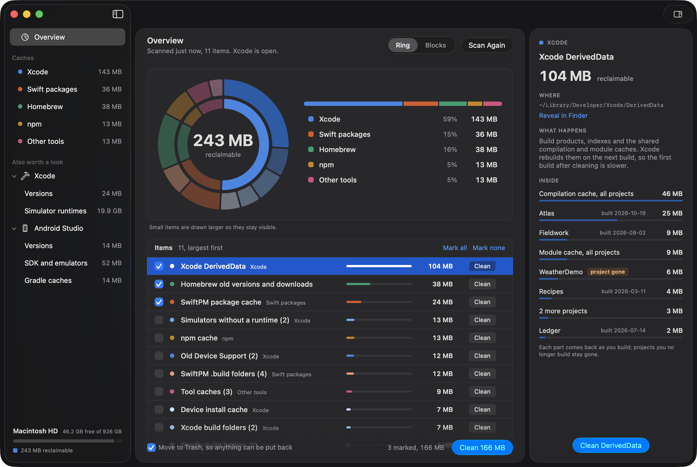

# DevSweep

A macOS app and a command line tool, `devsweep`, that show how much space
developer caches take up (Xcode's DerivedData, old Device Support, SwiftPM,
Homebrew, npm, Gradle and more) and reclaim it safely.



The command line tool is a Swift port of `devclean`, a bash script in
[a dotfiles repository](https://github.com/JaviLorbada/dotfiles). That is the
only thing the name devclean means here: the original script, its bats suite
and the parity checks. Run under the script's name, the tool prints exactly
what the script prints, byte for byte, which is how those checks run it. The app shows the same scan
in a window and adds a Trash with Put Back, a menu bar item and a daily scan.

## Safety first

DevSweep deletes only caches that tools rebuild or download again, and it is
built to err on the side of keeping things.

- **Report by default.** `devsweep` on its own only reports. It deletes only
  with `--run`, after asking; without a terminal to ask in, it needs `--yes`.
  The app only cleans when you press Clean.
- **Trash by default.** The app moves what it cleans to the Trash, with Put
  Back on each item. Deleting for good is a setting, and asks first.
- **Inside your home folder only.** A folder is acted on only if it is a
  directory, is not itself a symlink, and resolves strictly inside your home
  folder. Each one is checked again right before it goes; one that changed
  since the scan is skipped with a warning.
- **Never what git tracks.** Build folders are removed only when git provably
  tracks nothing in them. Any doubt keeps the folder.
- **Not while Xcode runs.** Cleaning the Xcode items waits until Xcode and
  Simulator have quit.
- **Worktrees only with nothing to lose.** The app removes a git worktree only
  when you ask, with git's own `git worktree remove`, and only when it has no
  changes waiting to be committed and a branch holds every commit in it. The
  branch stays.
- **Never touched:** Xcode Archives (their dSYMs symbolicate crash reports),
  simulators that still work, simulator runtimes, installed Xcodes, Android
  Studio and its SDK and emulators, build folders tracked in git, and
  anything outside your home folder. Runtimes, Xcodes and Android Studio's
  files are listed with their sizes, and how to remove them yourself.
- It never runs as root.

## What it cleans

| Item | What | Where |
|---|---|---|
| `derived-data` | Xcode's build products, indexes and shared caches | `~/Library/Developer/Xcode/DerivedData`, or Xcode's custom location inside home |
| `simulators` | Simulators whose runtime is gone | removed by `xcrun simctl delete unavailable` |
| `device-installs` | Cached app installs for physical devices | the CoreDevice cache in `~/Library/Containers` |
| `device-support` | Device debug symbols, except the newest per device model | `~/Library/Developer/Xcode/<OS> DeviceSupport` |
| `swiftpm-cache` | SwiftPM's shared package clones | `~/Library/Caches/org.swift.swiftpm` |
| `swiftpm-builds` | `.build` folders next to a `Package.swift` | your project folders |
| `xcode-builds` | `build` folders holding Xcode output | your project folders |
| `gradle-builds` | `build` folders next to a Gradle build file | your project folders |
| `npm-cache` | npm's download cache | `~/.npm/_cacache`, `~/.npm/_npx` |
| `homebrew` | Old versions and downloads | removed by `brew cleanup` |
| `tool-caches` | CocoaPods, Carthage, Sourcery, Playwright and JetBrains Toolbox downloads | `~/Library/Caches` |

Project folders default to `~/Developer`, `~/Development`, `~/dev`,
`~/Documents/Workspace` and `~/Projects`.

## Install

Releases are on the [releases page](https://github.com/JaviLorbada/devsweep/releases):
`devsweep-<version>-macos.zip` holds the command line tool, `DevSweep-<version>.zip`
the app. Both need macOS 26.

Until releases are notarized (see below), macOS refuses to open the app the
first time: Control-click it in Finder and choose Open, or allow it in System
Settings > Privacy & Security. For the tool, after unzipping:
`xattr -d com.apple.quarantine devsweep`.

A Homebrew tap is planned; `packaging/` has the formula and the cask.

### From source

```bash
git clone https://github.com/JaviLorbada/devsweep.git && cd devsweep
make app                       # build/DevSweep.app
Scripts/install-cli.sh         # links the release devsweep into ~/.local/bin
```

`Scripts/install-cli.sh` links `devsweep` into `~/.local/bin`, and
`--uninstall` takes the link out and puts back anything it replaced.

## Use

```bash
devsweep                          # report only
devsweep --run                    # delete the items in the report, after asking
devsweep --skip homebrew,npm-cache --projects ~/Code:~/Work
devsweep --help
```

`DEVSWEEP_PROJECT_DIRS` and `DEVSWEEP_APPLICATIONS_DIRS` set the project and
applications folders; `NO_COLOR` turns colors off.

The app scans when it opens. Mark items, or click Clean on one, and press
Clean. To keep most of DerivedData, tick single projects, or a shared cache,
in the inspector and clean just those; a project can go while Xcode is open,
after a question, since Xcode may have it open. The build folders list each
folder with its size, to tick the same way. ⌘1 and ⌘2 switch the chart between the ring and blocks, ⌥⌘I shows or
hides the inspector, and ⌘R scans again. In a window too narrow for the
inspector beside the center, it floats over the center's trailing side
instead. The sidebar's "Also worth a look" lists installed Xcodes and simulator
runtimes, and what Android Studio keeps: its installs, the SDK's system
images, platforms and build tools, emulators, and Gradle's caches, flagging
what looks unused. Under Git it lists the worktrees of the repositories in
your project folders, wherever the worktrees are, with their size, branch and
last commit, and removes one with nothing to lose when you ask. `devsweep`
lists them too, with the command for each. Settings has the project folders, items to skip, when
something counts as unused, how cleaning starts out, whether to scan on
opening, and whether to show the menu bar item. The menu bar item shows the
icon's ring in one color and the free space, and keeps the app running after
its window closes; while the app runs it scans once a day and says so when
DerivedData has grown past a threshold. Nothing starts it at login.

## Build and test

macOS 26 and Xcode 26 or newer. The only package dependency is
swift-argument-parser.

```bash
make build        # the kit, the tool and the app
make test         # Swift Testing, in parallel
make lint         # SwiftFormat and SwiftLint, strict
make acceptance DOTFILES=../dotfiles   # parity with the bash script
make app          # build/DevSweep.app
make release      # zips of the tool and the app in dist/
```

`AGENTS.md` has the rules for working on the code; `docs/DEVELOPMENT.md`,
`docs/architecture.md`, `docs/packaging.md` and `docs/RELEASING.md` the rest.
The app's original design and mockup are in [docs/design](docs/design/README.md).

## How parity with the script is tested

Three layers, all in CI:

1. **Swift Testing**: the kit and the app, each test on a fake home folder in
   its own temp folder, with fake tools, Trash and clock.
2. **The script's own bats suite**, copied unchanged from the dotfiles
   repository and run against the Swift binary: 52 of 52 pass. This is the
   acceptance test.
3. **Side by side**: the bash script and the binary run against the same fake
   home with the same stubs on `PATH`, and their output, exit status, tool
   calls and the folders left after `--run` are compared. They are identical.

## Notarizing a release

Until this is set up, releases are signed ad hoc, not notarized, and the
release notes say so. Everything is in place for the day it is:

1. **Apple Developer Program** membership, for the team's Developer ID.
2. **A Developer ID Application certificate**: create it in Xcode (Settings >
   Accounts > Manage Certificates) or on developer.apple.com, then export it
   from Keychain Access with its private key as a `.p12`, with a password.
3. **An App Store Connect API key** for notarization: App Store Connect >
   Users and Access > Integrations > App Store Connect API, a key with the
   Developer role. Note its **Key ID** and the **Issuer ID** above the list,
   and download the `AuthKey_<KeyID>.p8` file (it can be downloaded once).
4. **GitHub secrets** on the repository (Settings > Secrets and variables >
   Actions):

   | Secret | Value |
   |---|---|
   | `MACOS_SIGNING_P12` | the `.p12`, base64: `base64 -i DeveloperID.p12 \| pbcopy` |
   | `MACOS_SIGNING_P12_PASSWORD` | the `.p12`'s password |
   | `ASC_KEY_ID` | the Key ID |
   | `ASC_ISSUER_ID` | the Issuer ID |
   | `ASC_PRIVATE_KEY_P8` | the text of the `.p8` file |

With all five set, the release workflow signs both the app and the tool with
the hardened runtime and a secure timestamp, notarizes them, staples the
ticket to the app and checks it with `spctl`. Locally, the same happens with
`make release` when `DEVELOPER_ID_APPLICATION` (the identity's full name, as
`security find-identity -v -p codesigning` prints it), `ASC_KEY_ID`,
`ASC_ISSUER_ID` and `ASC_PRIVATE_KEY_P8` (the `.p8`'s path) are set. App
Sandbox stays off, and no entitlements are needed: the app reads other
tools' caches and runs simctl and brew.

## How the tool matches the script

The flags, environment variables, messages, exit codes and output are the
script's. Arguments are read with the script's own rules first (left to
right, the first unknown option fails, `--help` wins only if nothing before
it failed, `--skip` and `--projects` take the next argument whatever it is),
then handed to swift-argument-parser, which keeps the script's exact errors.

The whole run, from preflight to "Done.", is `CommandLineSession` in the kit,
writing to a `Terminal`; the binary gives it standard input and output and
the tests a buffer, so the tests exercise the code the binary runs. Every
tool is found through `PATH` when it runs and runs with `LC_ALL=C`. Sizes
count allocated blocks the way `du -sk` does: every entry's `st_blocks`,
hard-linked files once, symlinks never followed. That is why an installed
Xcode shows about 3.7 GB, not the 9 GB Finder reports: its files are stored
compressed, and 3.7 GB is what removing it frees.

### Where it is stricter than the script

- Device Support folder names containing a tab or newline broke the script's
  rows; they are kept and never listed.
- A DerivedData project name longer than 21 bytes is cut at a whole
  character, never in the middle of one.
- A runtime whose last-used date doesn't parse made the script abort; it is
  now simply not flagged.
- With `HOME` unset the script failed with "HOME: unbound variable"; the port
  says "HOME must be your home folder."
- A folder whose contents can't be read is reported with what could be
  measured, as the script did, and flagged as unknown so the app doesn't
  show zero.

## The kit

```swift
let engine = try Engine(config: ScanConfig.fromEnvironment(environment),
                        dependencies: .live(environment: environment))
for await event in engine.scan() { ... }   // projectFolders, started, progress, warning,
                                           // finished, done, extras, android
let outcome = await engine.clean(result, mode: .trash)   // or .delete, with
                                                         // { bytes in } for progress
let restored = await engine.putBack(outcome)
```

Everything with a side effect comes through `Dependencies`: the tools, the
file system and the clock. `docs/architecture.md` describes the seams.

## Support

To support DevSweep: [GitHub Sponsors](https://github.com/sponsors/JaviLorbada) or [Ko-fi](https://ko-fi.com/javilorbada).

## License

MIT. See [LICENSE](LICENSE).
