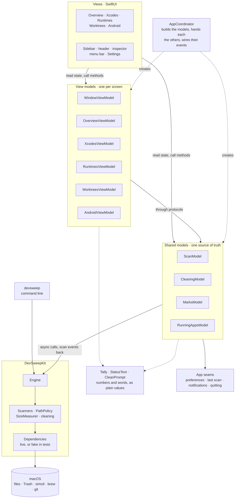
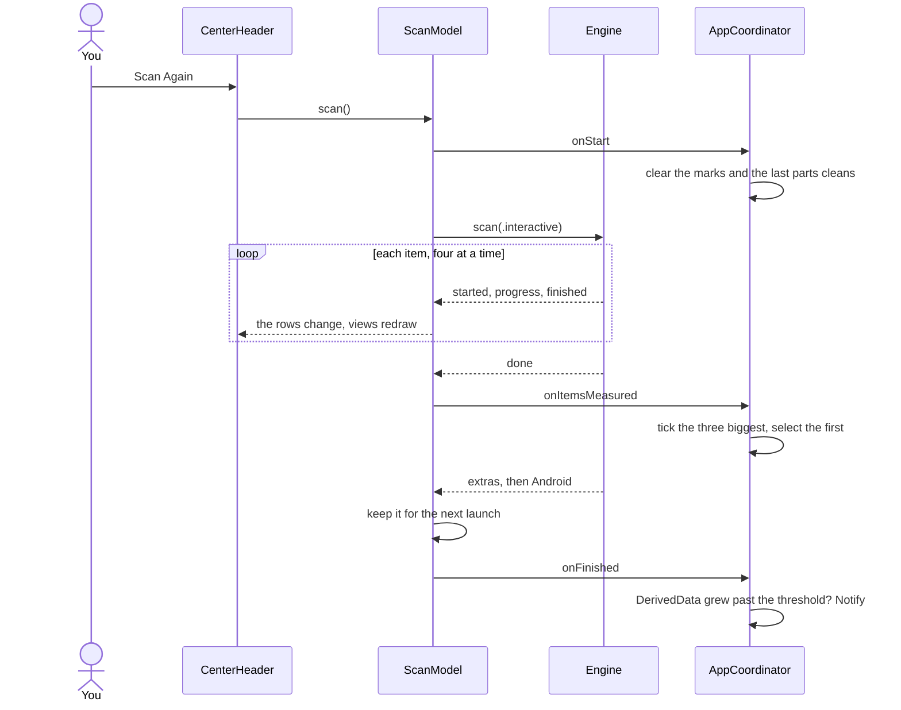
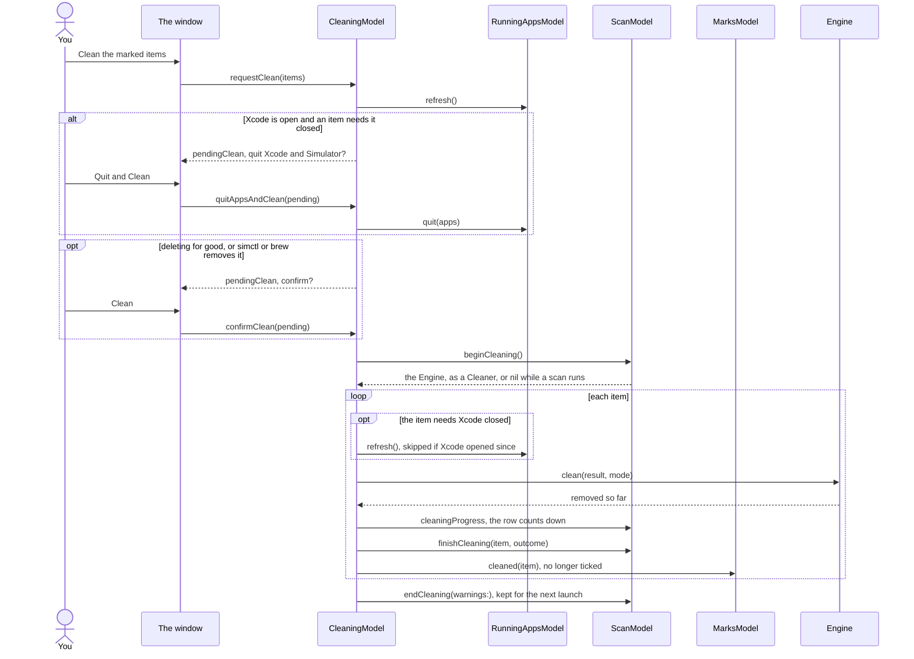

# Architecture

One Swift package, three products:

| Target | What it is |
|---|---|
| `DevSweepKit` | Scanning, measuring, the path policy, cleaning, the report. No AppKit except where a macOS API needs it (the Trash). |
| `devsweep` | The command line tool on top of the kit. Run under the original script's name, `devclean`, it behaves as the bash script, byte for byte. |
| `DevSweepApp` | The SwiftUI app: the window, Settings and the menu bar item. |

## The scan

`Engine` scans one home folder. `Engine.scan(_:)` returns an `AsyncStream<ScanEvent>`:
the project folders it searches, then each item `started`, its `progress` and
`finished`, `done` with the total, and then the extras (installed Xcodes and
simulator runtimes) and, when the app asks for it, what Android Studio keeps.
The command line scans one item at a time in report order (`ScanOptions.report`);
the app scans four at a time, quickest first (`ScanOptions.interactive`).

Each item has a `Scanner`: it lists the folders the item would delete, each
through the path policy, and measures them the way `du -sk` does. Groups the
app lists but never cleans, like Android Studio's, have a `ListingScanner`:
the same contract with a listing for a result, so a clean step can be added
later without touching the command line's items.

`PathPolicy` is the safety rule in code: a path is acted on only when it is a
directory, not itself a symlink, and resolves strictly inside the resolved
home folder, checked when it is listed and again right before it goes.

Deleting for good goes through `TreeRemover`, about twice as fast as
`FileManager` on a DerivedData folder: four threads share the walk, and each
directory's files go in the order of their inode numbers, which APFS
removes fastest. Every step starts from the folder's parent, opened once,
and refuses a symlink anywhere along the path (`O_NOFOLLOW_ANY`), so the
walk can't be led out of the folder; directories are listed with
`getattrlistbulk`, which gives each file's size for the progress as well.
Whatever it can't remove, `FileManager` tries again and says why.

## Seams

Everything with a side effect sits behind a protocol, so tests run it fake.
The kit's public entry points, `Engine.init(config:dependencies:)` and
`CommandLineSession.run(_:environment:dependencies:terminal:)`, take one
`Dependencies` value:

| Seam | Protocol | Live | In tests |
|---|---|---|---|
| Processes: simctl, brew, defaults, xcode-select, git | `SimctlClient`, `BrewClient`, `XcodeDefaultsReading`, `XcodeSelectReading`, `GitClient`, over `ProcessRunner` | Found through `PATH` | `FakeTools` records calls and answers |
| Spotlight's last-used dates (mdls) | `LastUsedDateReading` | `SpotlightLastUsedDates` | A dictionary |
| Running apps | `RunningAppsChecking` | `PgrepRunningApps`; the app's `WorkspaceRunningApps` | A set |
| The Trash | `TrashService` | `SystemTrash` | `FolderTrash`, a folder inside the temp home |
| Files: list, attributes, read, remove | `FileSystemAccess` | `LiveFileSystem` | The temp folder itself, or a recording fake |
| The time | `WallClock` | `SystemClock` | `FixedClock` |

`Dependencies.live(environment:)` builds the real one; `Tools.unavailable` is
a machine with none of the tools, which the app's tests use. The path policy
and the `du`-style measurer stay on the real disk on purpose: they are the
safety rule and the numbers the report must match, and each test gets its
own temp folder to run them against.

The app adds its own:

| Seam | Protocol | Live | In tests |
|---|---|---|---|
| Preferences | `PreferencesStore` | `UserDefaults.standard` | `InMemoryPreferencesStore` |
| The last scan | `ScanMemoryStore` (kit) | `ScanStore`, a JSON file in Application Support | `InMemoryScanStore`, or the file in a temp home |
| Notifications | `NotificationPoster` | `UserNotificationPoster` | `SilentNotificationPoster`, a recording poster |
| Quitting Xcode and Simulator | `AppQuitting` | `WorkspaceAppQuitter`, as choosing Quit would | `FakeDeveloperApps`, which also says what runs |

No Swift test puts a stub on `PATH`; stubs on `PATH` live only in the bats
suite, which runs the built binary as a user would.

## The app

The kit is the domain and the data: its model types are the entities,
`Engine`'s methods the use cases, the scanners, `PathPolicy` and the cleaner
the rules, and `Dependencies` the ports, live or fake. The app is MVVM on
Observation, in four kinds of piece:

- **Shared models** hold what several screens read, once.
- **View models**, one per screen, hold what that screen owns.
- **Plain values** work out the numbers and the words, with nothing to observe.
- **`AppCoordinator`** builds them all and wires one model's events to the others.

Arrows point the way calls go; state comes back up through Observation.
Views call view models and shared models; view models call shared models;
only shared models call the kit, and only the kit touches macOS. No view
reads the coordinator: the scenes put its models in the environment with
`environment(models:)`, and each view takes only those it reads. Rows,
cells and ring segments take plain values.

| Type | What it owns | Who uses it |
|---|---|---|
| `WindowViewModel` | The screen on show, Ring or Blocks, whether the inspector shows and where: docked, or floating once the window is too narrow. | Sidebar, header, the View menu |
| `OverviewViewModel` | The selected item, picking a family, the status line. | Ring, Blocks, items list, inspector |
| `XcodesViewModel` | The selected Xcode and the screen's subtitle. | Xcode versions |
| `RuntimesViewModel` | The selected runtime, its removal sheet, the subtitle. | Simulator runtimes |
| `WorktreesViewModel` | The selected worktree, its removal sheet, the subtitle, the git command. | Worktrees |
| `AndroidViewModel` | A selection for each Android screen, their lists and subtitles. | The three Android screens |
| `Removal` | One removal sheet's state: what is waiting, whether it runs, why it failed. | Runtimes, worktrees |
| `ScanModel` | The rows, one per item, and the scan that fills them; the listings, the free space, the last scan kept for the next launch. Only it changes the rows, and a scan and a clean never run at once. | Every screen, the menu bar, `CleaningModel` |
| `CleaningModel` | A clean from the question to the end: quitting Xcode, confirming, the Trash or deleting, Put Back, cleaning parts, this session's totals, the notices. | Overview footer, items list, inspector, the window's alerts |
| `MarksModel` | What is ticked, items and parts, and the three biggest ticked by default. | Items list, inspector, `CleaningModel` |
| `RunningAppsModel` | Whether Xcode and Simulator are open, and quitting them. | `CleaningModel`, the status line |
| `Tally` | Row order, totals, each family's share, the ring's weights. | `ScanModel`, the charts, the sidebar |
| `StatusText` | The status lines, the subtitles' words, "3 minutes ago". | The view models, the menu bar |
| `CleanPrompt` | The questions' words, by name up to three and by count past that. | `CleaningModel`, the window's alerts |
| `AppCoordinator` | Builds everything; wires a scan's start and end to the marks, the selection and the growth check; the half-minute tick and the daily scan, which waits while a clean runs or waits on an answer. | The app's scenes and menus |

State is `private(set)`. What a view binds stays settable (the screen, the
chart, the Trash toggle, an open sheet); everything else changes through a
method named for what it does: `select(_:)`, `askToRemove(_:)`,
`requestClean(_:)`.

### Protocols

The models and view models take each other through protocols, each named
for what its user reads and no more. `AppCoordinator` is the one place that
names the classes: it builds each model and hands it the real ones. A test
hands it fakes instead, so a view model's test needs no scan.

| Protocol | What it gives | Who conforms | Who takes it |
|---|---|---|---|
| `ScanResults` | The tally and the facts the status lines are written from. | `ScanModel` | `OverviewViewModel`, `MarksModel` |
| `Listings` | The Xcodes, runtimes, worktrees and Android lists; removing a runtime or a worktree. | `ScanModel` | The Xcodes, runtimes, worktrees and Android view models |
| `ScanRows` | The rows as a clean changes them, and the lock that keeps a scan and a clean apart: taking it hands over the `Cleaner`. | `ScanModel` | `CleaningModel` |
| `Cleaner` | Cleaning an item or some of its parts, and Put Back. | The kit's `Engine` | `CleaningModel`, only from `ScanRows.beginCleaning()` |
| `Marking` | The ticked parts, and clearing what was cleaned. | `MarksModel` | `CleaningModel` |
| `RunningApps` | Whether Xcode and Simulator are open, and quitting them. | `RunningAppsModel` | `CleaningModel`, `OverviewViewModel` |
| `CleaningTotals` | What this session moved to the Trash and deleted. | `CleaningModel` | `OverviewViewModel` |
| `Navigation` | The screen on show, and showing another. | `WindowViewModel` | `OverviewViewModel`, `AndroidViewModel` |

Three things have no protocol, on purpose:

- **`AppCoordinator`.** Nothing depends on it: it calls the models and sets
  their hooks (`scan.onStart`), and nothing calls back into it. Its tests
  build it on a fake home and check that wiring.
- **The view models, as views see them.** A view takes its view model's
  class from the environment, as SwiftUI's `@Environment(Type.self)` needs.
  The layout tests and the screenshots cover the views.
- **`Preferences`.** It is settings, already behind `PreferencesStore`, and
  a test builds it on an in-memory store in one line.

Below the models, the kit's own protocols fake the world: the disk,
processes, simctl, brew, git, the Trash and the clock, in `Dependencies`;
the app adds quitting apps, notifications, the preferences store and the
last scan's file.

### Folders

The app's folders follow those kinds, and its tests use the same ones.

| Folder | What's in it |
|---|---|
| `App` | `DevSweepApp` (the scenes and the menus), `AppCoordinator`, the daily scan and the growth check. |
| `Protocols` | What the models and view models see of each other. |
| `Models` | The shared models and `Preferences`. |
| `ViewModels` | A view model per screen, and `Removal`. |
| `Values` | `Tally`, `StatusText`, `CleanPrompt`, the items' words, `WindowLayout`'s sizes. |
| `Views` | A folder per screen (`Overview`, `Xcodes`, `Runtimes`, `Worktrees`, `Android`), the window's frame (`Window`), `MenuBar`, `Settings`, pieces the screens share (`Shared`), and `Style`: the palette and the icon. |
| `System` | The app's own ways into macOS: quitting Xcode, Reveal in Finder. |
| `Debug` | Development builds only: the debug launch and the screenshots. |

### A scan

### A clean

### Layout

Layout decisions that depend on width are made inside a `GeometryReader`
with a fixed height, so no view's minimum size follows the width it last had;
`WindowLayout` holds the column sizes the layout tests check every screen
against.

## Tests

- Swift Testing for the kit and the app, run in parallel: every test makes its
  own temp folder and fakes; nothing is shared between tests.
- In the app, each model and view model has its own test file, named after
  it, that builds it with fakes for the protocols it takes: an
  `OverviewViewModel` gets a `FakeScanResults` with the rows the test needs,
  a `CleaningModel` gets fake rows that never let a clean begin, so its
  tests see what it asks without anything being cleaned. `Tally`,
  `StatusText` and `CleanPrompt` are checked without a model.
- Some behaviour only shows with the real pieces together, so a few tests
  build the whole app on a fake home: the coordinator's wiring, the views'
  layout, and, in `Flows`, a clean from the question to the folders gone and
  back from the Trash.
- The bats suite from the dotfiles repository, run against the binary: the
  acceptance test that the tool behaves as the bash script did.
- `Scripts/compare.sh` runs the bash script and the binary side by side on
  the same fake home and diffs output, exit status, tool calls and what is left.
